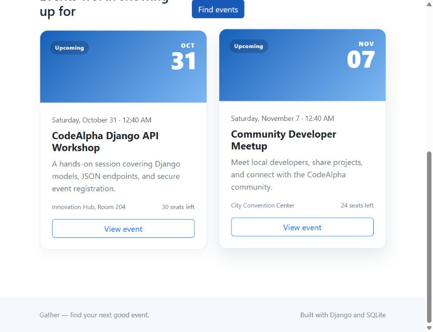
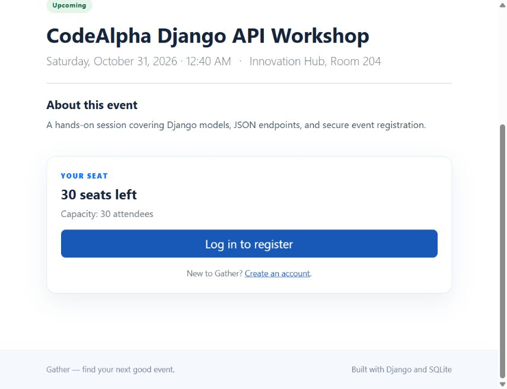

# Code Alpha Task 2 — Event Registration System

A beginner-friendly event registration website and JSON API built with Python, Django, SQLite, Django templates, Bootstrap 5, CSS and a small amount of JavaScript. Visitors can discover events; signed-in users can register, review their plans and cancel an upcoming registration; staff manage the catalogue and registrations in Django Admin.

## Architecture

```text
Browser
  → config/urls.py and events/urls.py route the request
  → events/views.py loads data or handles a form action
  → events/api.py returns JSON for API clients
  → events/forms.py validates account and admin input
  → events/services.py applies registration rules in a transaction
  → events/models.py reads and writes through Django ORM
  → SQLite stores the records
  → a Django template renders the response as HTML
```

The browser never supplies a user ID or trusted seat count. Django gets the signed-in user from the session, and remaining seats are calculated as event capacity minus registration rows.

## Folder structure

```text
CodeAlpha_Task2/
├── config/
│   ├── __init__.py
│   ├── asgi.py
│   ├── settings.py
│   ├── urls.py
│   └── wsgi.py
├── events/
│   ├── migrations/0001_initial.py
│   ├── __init__.py
│   ├── admin.py
│   ├── apps.py
│   ├── api.py
│   ├── forms.py
│   ├── models.py
│   ├── services.py
│   ├── tests.py
│   ├── urls.py
│   └── views.py
├── screenshots/
│   ├── event-list.png
│   └── event-detail.png
├── static/
│   ├── css/site.css
│   └── js/site.js
├── templates/
│   ├── events/
│   │   ├── cancel_registration.html
│   │   ├── dashboard.html
│   │   ├── event_detail.html
│   │   └── event_list.html
│   ├── registration/
│   │   ├── login.html
│   │   └── signup.html
│   └── base.html
├── .gitignore
├── manage.py
├── README.md
└── requirements.txt
```

## What each file does

| Path | Purpose |
| --- | --- |
| `manage.py` | Runs Django management commands. |
| `requirements.txt` | Pins the supported Django minor release range. |
| `.gitignore` | Keeps the local database, secrets, caches and virtual environment out of Git. |
| `config/settings.py` | Project apps, middleware, templates, SQLite, timezone, static files and authentication redirects. |
| `config/urls.py` | Admin, login, logout and event-app URL entry points. |
| `config/asgi.py`, `config/wsgi.py` | Deployment server entry points. |
| `events/models.py` | Event and Registration tables, validation, capacity calculation and unique registration constraint. |
| `events/forms.py` | Signup, login and Django Admin event forms with Bootstrap classes. |
| `events/services.py` | Transactional registration/cancellation rules and concurrency protection. |
| `events/views.py` | Event list/detail, signup, dashboard and POST actions. |
| `events/api.py` | JSON endpoints for public event discovery and authenticated registration management. |
| `events/urls.py` | Routes for the event app. |
| `events/admin.py` | Searchable and filterable staff management screens. |
| `events/migrations/0001_initial.py` | Initial schema, including the database-level unique user/event constraint. |
| `events/tests.py` | Automated tests for accounts, browsing, registration, capacity, cancellation and admin access. |
| `templates/base.html` | Shared navigation, message area, footer and Bootstrap assets. |
| `templates/events/event_list.html` | Searchable event cards and upcoming/past/all filter. |
| `templates/events/event_detail.html` | Event information, seats and registration action. |
| `templates/events/dashboard.html` | Current user's upcoming registrations and past event history. |
| `templates/events/cancel_registration.html` | Cancellation confirmation page; the change is submitted with POST. |
| `templates/registration/login.html`, `signup.html` | Authentication screens. |
| `screenshots/` | Screenshots of event discovery and event details. |
| `static/css/site.css` | Responsive blue-and-white page styling. |
| `static/js/site.js` | Optional browser confirmation on forms marked with `data-confirm`; server checks remain authoritative. |

## Setup and run locally

Commands below use PowerShell on Windows. Python 3.10 or newer is recommended.

```powershell
cd D:\EventManagementProject
py -m venv .venv
.\.venv\Scripts\Activate.ps1
python -m pip install --upgrade pip
pip install -r requirements.txt
python manage.py migrate
python manage.py createsuperuser
python manage.py runserver
```

Open `http://127.0.0.1:8000/` to browse events and `http://127.0.0.1:8000/admin/` to manage events. The development database is created as `db.sqlite3` in the project root and is excluded from Git.

If PowerShell blocks activation, allow scripts for the current terminal with `Set-ExecutionPolicy -Scope Process -ExecutionPolicy Bypass`, then activate the environment again.

### Other shells

```bash
python -m venv .venv
source .venv/bin/activate
python -m pip install --upgrade pip
pip install -r requirements.txt
python manage.py migrate
python manage.py createsuperuser
python manage.py runserver
```

## Database and event workflow

1. `Event` stores title, description, venue, date/time, capacity and creation time. Its status is calculated as upcoming, full or completed.
2. `Registration` links Django's authenticated user to an event and records when they registered. The unique constraint on `(user, event)` prevents duplicates even if a view check is bypassed.
3. A registration form submits a CSRF-protected POST. `login_required` requires a valid session, so the view gets the attendee from `request.user`.
4. The registration service opens a database transaction, locks the event row, checks the date, duplicate and current registration count, then creates the registration. For SQLite, which ignores `SELECT FOR UPDATE`, it performs a no-op update on the event row first to obtain SQLite's writer lock before counting. Other supported relational backends use row locking. The database constraint remains the final duplicate guard.
5. Seats are never stored as a second editable value. Each page computes `max(capacity - registration_count, 0)` from the source records.
6. Cancellation is also a POST and scopes the registration to the signed-in owner. A passed event cannot be cancelled. GET only displays the confirmation screen.
7. Django Admin uses the same event validation and prevents an administrator from lowering capacity below existing registrations.

Authentication uses Django's password hashing and session middleware. Signup creates a Django user and signs them in. Login verifies the submitted credentials and issues the session cookie; logout is a CSRF-protected POST. The dashboard filters registrations using the session's user and splits them according to event date.

## JSON API

The website and API share the same Django models and registration service. Public event endpoints are read-only; registration management uses Django session authentication. For unsafe methods, Django CSRF protection remains enabled, so a browser client sends its `csrftoken` cookie in the `X-CSRFToken` header. The API takes the user from the authenticated session and never accepts a user ID or seat count from the request.

| Method and path | Access | Result |
| --- | --- | --- |
| `GET /api/events/` | Public | Upcoming events as JSON by default. Accepts `?status=upcoming\|past\|all` and `?q=search text`. |
| `GET /api/events/<event_id>/` | Public | One event, its status and current available seats. |
| `POST /api/events/<event_id>/registrations/` | Signed in + CSRF token | Registers the current user. Returns `201`; duplicate/full/past cases return `409`. Send no user ID or capacity. |
| `GET /api/registrations/` | Signed in | Returns the caller's registrations split into `upcoming` and `past`. |
| `DELETE /api/registrations/<registration_id>/` | Owner signed in + CSRF token | Cancels the caller's upcoming registration. Returns `204`; another user's registration appears as `404`. |

Example public request:

```powershell
Invoke-RestMethod -Uri "http://localhost:8000/api/events/"
Invoke-RestMethod -Uri "http://localhost:8000/api/events/1/"
```

The API uses JSON objects with descriptive fields. For example, each event includes `id`, `title`, `description`, `venue`, `event_date`, `capacity`, `registered_count`, `available_seats` and `status`. Authentication failures return `401` JSON responses instead of redirecting API clients to the HTML login page.

## Migrations and tests

The initial migration is included. For a new database, `python manage.py migrate` applies it along with Django's built-in auth/admin/session migrations. If you change a model later, create and apply a new migration:

```powershell
python manage.py makemigrations
python manage.py migrate
```

Run the included tests with:

```powershell
python manage.py test
```

## Repository

Published at [ArijitPan15/CodeAlpha_Task2](https://github.com/ArijitPan15/CodeAlpha_Task2).

## How the website works

Visitors browse and filter upcoming or past events, then open an event to check its date, venue and remaining seats. They create an account or log in before reserving a seat. The dashboard lists their registrations and lets them cancel an upcoming reservation; organizers manage events and registrations in Django Admin.

### Browse events



### View an event and register

The event page shows its details and current availability. After signing in, the visitor can reserve a seat; the dashboard then shows that registration and provides a cancellation action.



## Deployment notes

The included secret key and `DEBUG=True` default are for local learning only. Before deploying, set `DJANGO_SECRET_KEY` to a private random value, set `DJANGO_DEBUG=False`, set `DJANGO_ALLOWED_HOSTS` to the real hostnames, and configure a production-grade database and static-file hosting. Bootstrap assets load from the jsDelivr CDN.
